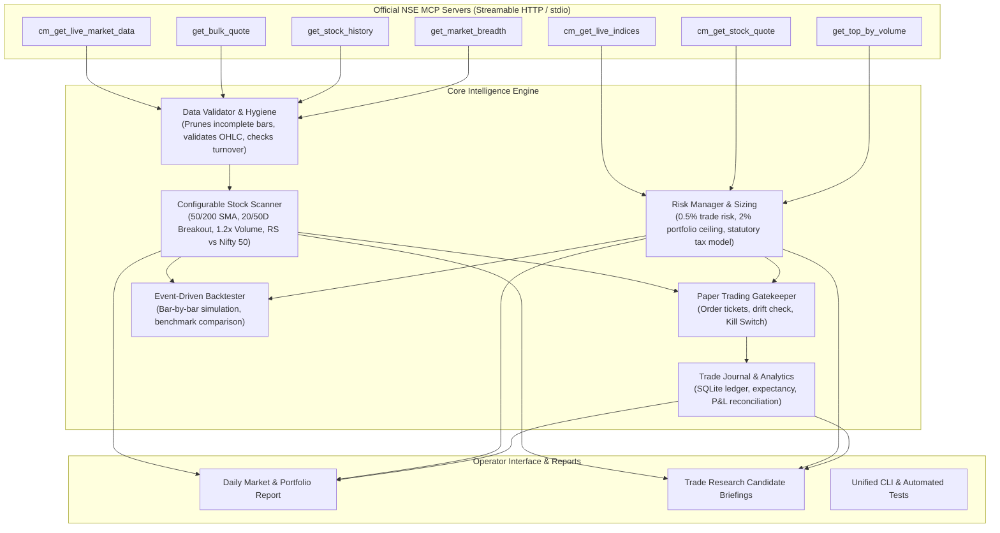

# Indian Equity Swing Trading Intelligence System

An AI-assisted, evidence-based swing trading research system built on Google Antigravity and the connected Official NSE Model Context Protocol (MCP) servers (`cm-market` and `nse-bhavcopy`).

Designed with strict adherence to **capital preservation**, **repeatable processes**, **transparent mathematical calculations**, and **zero look-ahead bias**.

---

## 1. System Architecture



---

## 2. Constraints & Safety Rules

- **Segment:** NSE Cash Equity (CNC Delivery) exclusively. Strictly **No Futures and Options (F&O)**.
- **Holding Period:** Several days to several weeks.
- **No Guaranteed Returns:** Hypotheses are subjected to empirical backtesting and risk budgeting.
- **No Invented Data:** All prices, candles, volumes, balances, and fills are fetched directly from Official NSE MCP or tagged `ESTIMATED`.
- **Look-Ahead Bias Elimination:** Incomplete daily bars during market hours are stripped. Breakout resistance levels are computed strictly using bars prior to the evaluated candle.
- **No Averaging Down:** The system automatically locks and rejects new buy proposals for any symbol currently showing an unrealized loss in the live portfolio.
- **Capital Preservation:** Single trade risk is capped at **0.5%** of equity; aggregate open risk is capped at **2.0%**; max **5** simultaneous positions.
- **Execution Safety:** Official NSE MCP is strictly read-only. Live broker execution is locked behind a human confirmation gate with a global emergency **Kill Switch**.

---

## 3. Directory Layout

```
├── config/
│   └── trading_config.json        # Configurable scanner thresholds, risk limits, fees
├── src/
│   ├── data_validator.js          # Incomplete candle pruning, OHLC sanity, turnover checks
│   ├── scanner.js                 # 50/200 MA trend, breakout resistance, volume surge, RS
│   ├── risk_manager.js            # Dynamic position sizing & statutory tax calculator
│   ├── journal.js                 # SQLite persistent trade ledger & performance analytics
│   ├── backtester.js              # Bar-by-bar backtesting with realistic slippage/fees
│   ├── paper_trader.js            # Paper trading engine, quote verification, Kill Switch
│   ├── report_generator.js        # Markdown report generator (Daily & Candidate cards)
│   └── cli.js                     # Unified Command Line Interface
├── tests/
│   ├── data_validator.test.js     # Tests for bar sanity, liquidity, incomplete candle pruning
│   ├── scanner.test.js            # Tests for trend, breakout lookahead guard, RS
│   ├── risk_manager.test.js       # Tests for 0.5% risk cap, 2% aggregate ceiling, fees
│   ├── journal.test.js            # Tests for SQLite ledger, metrics, portfolio reconciliation
│   ├── backtester.test.js         # Tests for simulation, exits, fee accounting
│   └── paper_trader.test.js       # Tests for order tickets, drift check, Kill Switch
├── reports/
│   └── DAILY_REPORT_2026-10-29.md # Sample generated live market and portfolio audit
├── docs/
│   └── MCP_CAPABILITY_INVENTORY.md# Exhaustive documentation of NSE MCP tools
├── package.json
└── mcp_config.json
```

---

## 4. Quick Start & CLI Usage

### Prerequisites
- Node.js v20+ (Tested on Node.js v24.20.0 with native ESM and SQLite support)
- Official NSE MCP servers (`cm-market`, `nse-bhavcopy`) configured in `mcp_config.json`

### Run Automated Tests
```bash
node --test tests/*.test.js
```
Runs the full 21-test suite verifying data hygiene, mathematical sizing, tax models, and safety switches.

### Generate Daily Market & Portfolio Report
```bash
node src/cli.js report
```

### Run Candidate Scanner
```bash
node src/cli.js scan
```

### Inspect Trade Journal & Performance Analytics
```bash
node src/cli.js journal
```

### Emergency Kill Switch
```bash
# Immediately halt any automated simulation or order ticket preparation
node src/cli.js kill

# Reset back to operational mode
node src/cli.js reset-kill
```

---

## 5. Mathematical Models

### Position Sizing Formula
$$\text{Quantity} = \left\lfloor \min\left( \frac{\text{Risk Budget}}{\text{Effective Risk Per Share}}, \frac{\text{Capital Allocation Ceiling}}{\text{Entry Price}} \right) \right\rfloor$$

Where:
- $\text{Risk Budget} = \text{Trading Equity} \times 0.005$ (0.5%)
- $\text{Effective Risk Per Share} = (\text{Entry Price} - \text{Stop Loss}) + 2 \times (\text{Entry Price} \times \text{Slippage Pct})$
- $\text{Capital Allocation Ceiling} = \text{Trading Equity} \times 0.20$ (20% maximum per stock)

### Realistic Indian Statutory Charges (Cash Delivery)
1. **Brokerage:** $0.05\%$ capped at ₹20 per executed order.
2. **STT (Securities Transaction Tax):** $0.1\%$ on Buy turnover and $0.1\%$ on Sell turnover.
3. **Exchange Transaction Charge (NSE):** $0.00297\%$ on total turnover.
4. **SEBI Turnover Fee:** ₹10 / Crore ($0.0001\%$).
5. **Stamp Duty:** $0.015\%$ on Buy turnover only.
6. **Depository Participant (DP) Charge:** ₹13.50 + 18% GST = ₹15.93 per scrip on Sell.
7. **GST:** $18\%$ on (Brokerage + Exchange Txn Charges + SEBI Charges).
8. **Estimated Slippage:** $0.1\%$ buffer on entry and exit executions.

