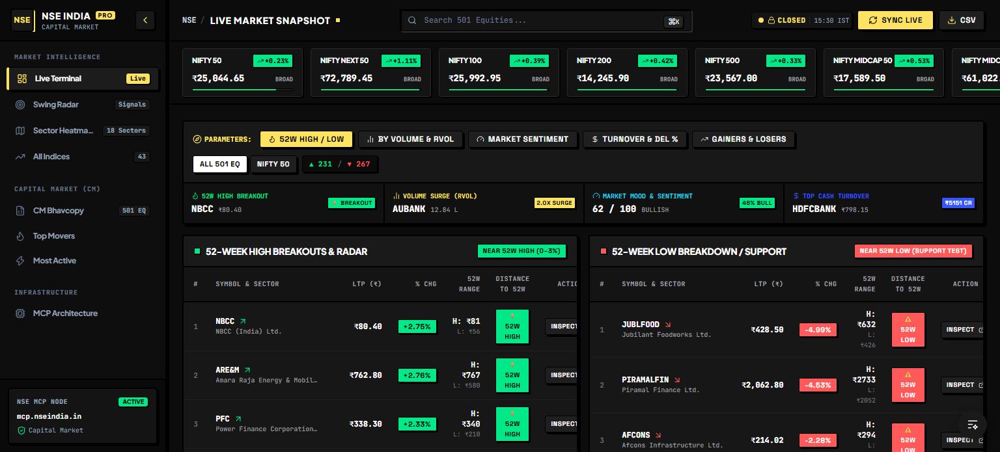
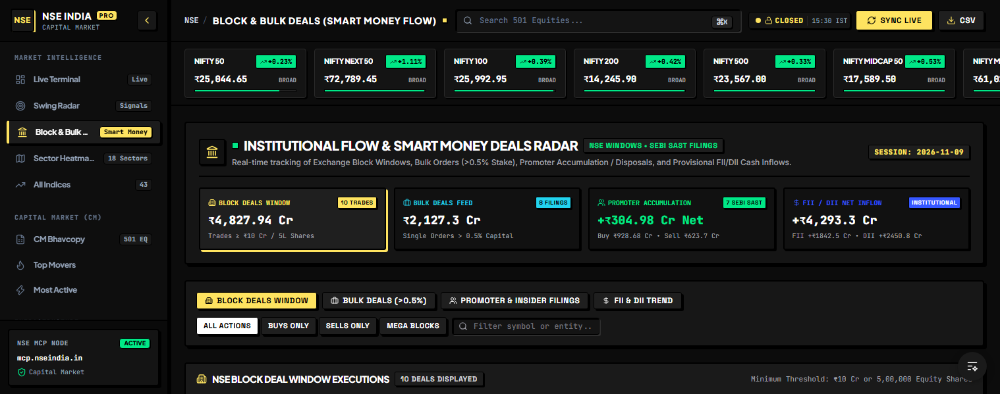
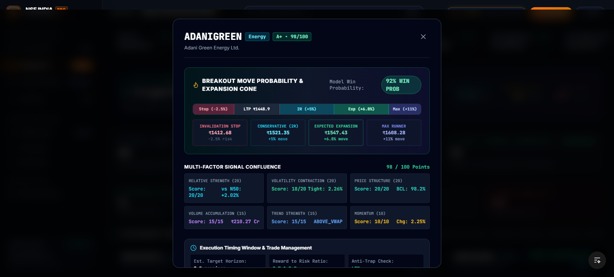
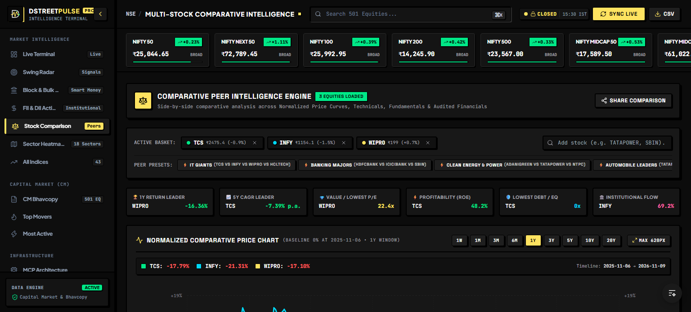
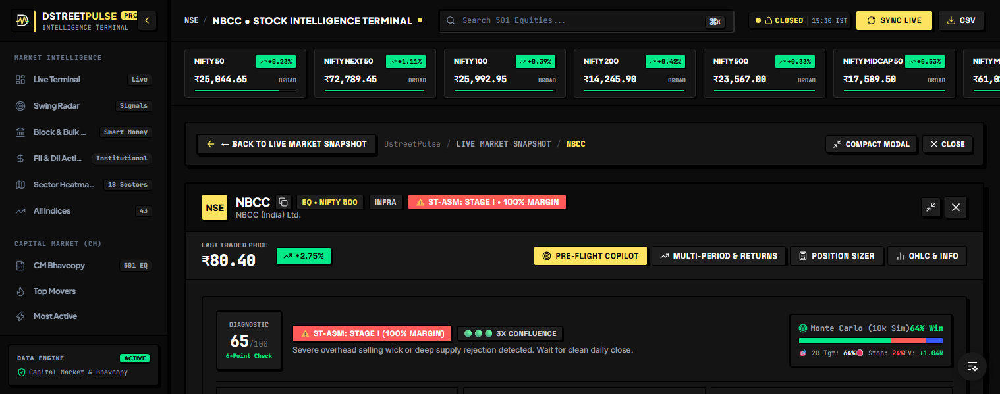
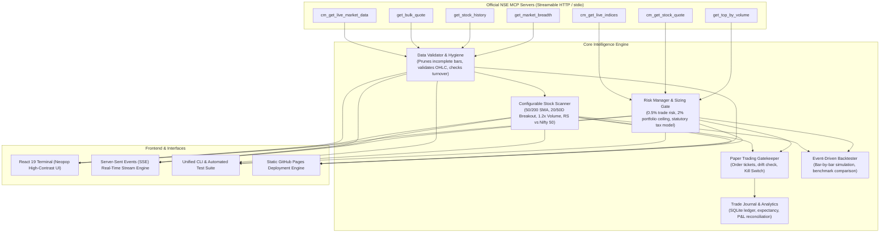

# <p align="center">DstreetPulse ⚡</p>
<p align="center">
  <strong>Next-Generation Institutional Trading Intelligence & Swing Radar Terminal for Indian Equities</strong>
</p>

<p align="center">
  <a href="https://abhijeetm96.github.io/DstreetPulse/"></a>
  <a href="https://github.com/Abhijeetm96/DstreetPulse"></a>
  <a href="https://github.com/Abhijeetm96/DstreetPulse/blob/main/LICENSE"></a>
  <a href="https://nodejs.org/"></a>
  <a href="https://react.dev/"></a>
  <a href="https://vite.dev/"></a>
</p>

---

## ⚡ Quick Links & Navigation

| 🌐 **Live Web Application** | 📖 **System Specification** | 🛠️ **CLI Reference** | 🛡️ **Risk & Safety Policy** |
|:---:|:---:|:---:|:---:|
| [**Launch Terminal →**](https://abhijeetm96.github.io/DstreetPulse/) | [Architecture Spec →](docs/ARCHITECTURE_SPEC.md) | [CLI Usage Guide →](#-cli-usage--operator-commands) | [Risk Governance →](#-mathematical-models--risk-governance) |

---

## 📌 Executive Summary

**DstreetPulse** is an institutional-grade, evidence-based swing trading intelligence terminal and scanning engine designed specifically for the **National Stock Exchange of India (NSE)**. 

Powered directly by the **Official NSE Model Context Protocol (MCP)** servers (`cm-market` and `nse-bhavcopy`), DstreetPulse eliminates emotional decision-making, look-ahead bias, and reckless leverage by strictly adhering to mathematical capital preservation, statutory tax accounting, and algorithmic trade gatekeeping.

> [!IMPORTANT]
> **Core Principle:** Strictly **NSE Cash Delivery (CNC)** equities. Zero Futures & Options (F&O), zero penny stocks, and mathematically guarded position sizing capped at **0.5% risk per trade**.

---

## 🖥️ Interactive Visual Tour

<details open>
<summary><h3>1. Live Market Overview & Real-Time Price Streaming</h3></summary>

Monitors 499 Nifty 500 constituents and 43 broad/sectoral indices. Features sub-second price ticks, off-market price freezing, advance/decline distribution, and macro indicators (India VIX & Market Breadth).

<p align="center">
  
</p>

- 🟢 **Live SSE Stream:** 1-second price delta flashes with green/red micro-animations.
- 🧊 **Session-Aware Freezing:** Automatically locks quotes and stamps "Market Closed / Session Ended" outside trading hours (09:15–15:30 IST) to eliminate synthetic drift.
- 🇮🇳 **Universal Rupee Denomination (₹):** Consistent formatting across all market caps and turnover calculations.
</details>

<details open>
<summary><h3>2. Smart Money Flow (Block & Bulk Deals + FII/DII Activity)</h3></summary>

Uncovers institutional accumulation and distribution patterns in real time. Filters transactions by minimum deal size, value threshold (e.g., >₹5 Cr), and client archetype.

<p align="center">
  
</p>

- 🐋 **Institutional Deals Ledger:** Instant classification into Block Deals, Bulk Deals, and Insider Trades.
- 🏛️ **FII & DII Net Flows:** Visual breakdown of institutional cash positions against daily Nifty 50 index trends.
- 🔍 **Live Search & Filter:** Filter deals by ticker, date range, or buy/sell execution direction.
</details>

<details>
<summary><h3>3. Swing Trade Breakout Radar (Multi-Strategy Scanner)</h3></summary>

Systematic multi-factor scanner that screens the Nifty 500 universe for high-probability swing trading setups based on technical breakouts, volume confirmation, and Relative Strength (RS).

<p align="center">
  
</p>

- 📈 **Breakout Engine:** Detects 20-day and 50-day closing-high breakouts with $\ge 1.2\times$ 20-day average volume confirmation.
- 💪 **Relative Strength (RS vs Nifty 50):** Automatically ranks stocks outperforming the benchmark index.
- 🛡️ **Anti-Lookahead Guard:** Resistance levels are derived strictly from historical closed candles prior to the current session.
</details>

<details>
<summary><h3>4. Multi-Stock Relative Performance Engine</h3></summary>

Compare up to 6 NSE equities simultaneously on a normalized percentage curve across multiple time horizons (1D, 1W, 1M, 3M, 6M, 1Y).

<p align="center">
  
</p>

- 🎯 **Preset Baskets:** Instant one-click comparisons for IT Majors, Banking Titans, Auto Champions, Energy Giants, and FMCG Leaders.
- 🏆 **Winner Badges:** Automatically identifies top performers and alpha generators per period.
- 📊 **Dynamic Normalization:** Re-bases all selected symbols to 0% at the start of the horizon for apple-to-apple comparison.
</details>

<details>
<summary><h3>5. Deep-Dive Institutional Stock Modal</h3></summary>

Comprehensive fundamental and point-in-time technical dossier for any scrip in the Nifty 500 universe.

<p align="center">
  
</p>

- 📋 **Complete OHLCV Breakdown:** Day high/low, 52-week envelope, volume, delivery percentage, and market cap rank.
- 📑 **Institutional Filings & Deals:** Relevant smart money trades linked directly to the scrip.
- ⌨️ **Keyboard Navigation:** Press `Arrow Left` and `Arrow Right` to browse through stocks sequentially.
</details>

---

## ⌨️ Terminal Hotkeys & Keyboard Navigation

DstreetPulse includes full professional trading terminal keyboard control:

| Key | Action | Destination / Function |
|:---:|:---|:---|
| <kbd>1</kbd> | Navigate Tab | **Live Market Snapshot** |
| <kbd>2</kbd> | Navigate Tab | **Swing Trade Breakout Radar** |
| <kbd>3</kbd> | Navigate Tab | **Block & Bulk Deals (Smart Money)** |
| <kbd>4</kbd> | Navigate Tab | **FII & DII Institutional Activity** |
| <kbd>5</kbd> | Navigate Tab | **Multi-Stock Comparison** |
| <kbd>6</kbd> | Navigate Tab | **Sector & Index Heatmaps** |
| <kbd>7</kbd> | Navigate Tab | **Broad & Sectoral Indices** |
| <kbd>8</kbd> | Navigate Tab | **Capital Market Bhavcopy** |
| <kbd>9</kbd> | Navigate Tab | **Top Movers (1D to 1Y Multi-Horizon)** |
| <kbd>Space</kbd> | Toggle Stream | **Pause / Resume Real-Time Price Engine** |
| <kbd>←</kbd> / <kbd>→</kbd> | Carousel | **Navigate Stocks in Modal View** |
| <kbd>Esc</kbd> | Modal Dismiss | **Close Stock Dossier** |

---

## 🏗️ Architecture & Data Pipelines



---

## 📐 Mathematical Models & Risk Governance

### 1. Dynamic Position Sizing Formula

Every order proposal is sized through an uncompromised risk gate:

$$\text{Quantity} = \left\lfloor \min\left( \frac{\text{Risk Budget}}{\text{Effective Risk Per Share}}, \frac{\text{Capital Allocation Ceiling}}{\text{Entry Price}} \right) \right\rfloor$$

$$\text{Risk Budget} = \text{Portfolio Equity} \times 0.005 \quad (0.5\% \text{ Max Loss})$$

$$\text{Effective Risk Per Share} = (\text{Entry Price} - \text{Stop Loss}) + 2 \times (\text{Entry Price} \times \text{Slippage Buffer})$$

$$\text{Capital Allocation Ceiling} = \text{Portfolio Equity} \times 0.20 \quad (20\% \text{ Max Position Size})$$

<details>
<summary><h3>2. Realistic Indian Statutory Charges Breakdown (Cash Delivery)</h3></summary>

Trading costs significantly impact long-term swing trading expectancy. DstreetPulse factors all statutory Indian taxation rules into backtesting and trade planning:

| Charge Type | Rate / Formula | Applicable Leg |
|:---|:---|:---:|
| **Brokerage** | 0.05% capped at ₹20 per order | Buy & Sell |
| **STT (Securities Transaction Tax)** | 0.10% on turnover | Buy & Sell |
| **Exchange Turnover Fee (NSE)** | 0.00297% on turnover | Buy & Sell |
| **SEBI Turnover Charge** | ₹10 per Crore (0.0001%) | Buy & Sell |
| **Stamp Duty** | 0.015% on turnover | Buy Only |
| **DP Charges (Depository Participant)** | ₹13.50 + 18% GST (₹15.93 flat) | Sell Only |
| **Goods & Services Tax (GST)** | 18% on (Brokerage + Exchange + SEBI) | Buy & Sell |
| **Slippage Buffer** | 0.10% execution drift guard | Buy & Sell |

</details>

---

## 💻 CLI Usage & Operator Commands

The terminal includes a unified Node.js CLI for headless operation, automated scanning, and journal reconciliation.

```bash
# 1. Run full 21-test automated suite (Data hygiene, sizing, tax models)
npm test

# 2. Start the interactive web terminal locally
npm run ui
# Terminal will be live at http://localhost:3000

# 3. Execute Nifty 500 breakout scanner
npm run scan

# 4. Generate daily portfolio and market audit report
npm run report

# 5. Inspect SQLite trade journal & expectancy
npm run journal

# 6. Build static production bundle for GitHub Pages
npm run build
```

<details>
<summary><h3>Emergency Kill Switch Protocol</h3></summary>

If anomalous market conditions or broker disconnects occur, the kill switch instantly freezes all simulated operations:

```bash
# Engage Kill Switch (Locks paper trading engine & order creation)
node src/cli.js kill

# Disengage Kill Switch (Restores normal operation)
node src/cli.js reset-kill
```
</details>

---

## 📂 Repository Structure

```
├── config/
│   └── trading_config.json        # Scanner thresholds, risk caps, statutory fee schedules
├── docs/
│   ├── images/                    # High-resolution terminal UI showcase screenshots
│   ├── ARCHITECTURE_SPEC.md       # Comprehensive architectural specification
│   ├── MCP_CAPABILITY_INVENTORY.md# Exhaustive NSE MCP tool mapping & schemas
│   └── index.html                 # GitHub Pages deployment build entrypoint
├── public/                        # Static assets, compiled JS/CSS bundles, sample data
│   ├── data/                      # Pre-baked offline market datasets for static demo
│   └── index.html                 # Local development server web root
├── src/
│   ├── react/                     # React 19 Frontend application (Components, Hooks, Tailwind)
│   ├── data_validator.js          # Incomplete candle pruning, OHLC sanity, turnover checks
│   ├── scanner.js                 # 50/200 MA trend, breakout resistance, volume surge, RS
│   ├── risk_manager.js            # Dynamic position sizing & statutory tax calculator
│   ├── journal.js                 # SQLite persistent trade ledger & performance analytics
│   ├── backtester.js              # Bar-by-bar backtesting with realistic slippage/fees
│   ├── paper_trader.js            # Paper trading engine, quote verification, Kill Switch
│   ├── report_generator.js        # Markdown report generator (Daily & Candidate cards)
│   ├── server.js                  # Express Node.js backend with SSE live streaming
│   └── cli.js                     # Unified Command Line Interface
├── tests/
│   ├── data_validator.test.js     # Data sanitation & look-ahead guard tests
│   ├── risk_manager.test.js       # Risk sizing & statutory tax calculation tests
│   └── time_machine_and_risk_gate.test.js # Monte carlo & risk gate tests
├── package.json
├── vite.config.js
└── mcp_config.json
```

---

## 🛡️ Safety & Capital Preservation Guardrails

1. **Zero F&O Leverage:** No derivatives, no shorting, no futures leverage. Cash equity exclusively.
2. **Strict Loss Ceilings:** Max **0.5%** risk per trade; max **2.0%** aggregate open portfolio risk.
3. **No Averaging Down:** The system automatically locks proposals for any symbol currently at an unrealized loss.
4. **Zero Look-Ahead Bias:** Resistance levels and scanner filters only reference completed historical candles.
5. **No Synthetic Drift:** Outside market hours (09:15–15:30 IST), live tickers freeze with "Market Closed" indicators.

---

## 📜 License

This project is open-source software licensed under the **[MIT License](LICENSE)**.

---

<p align="center">
  <strong>Built with precision for Indian Capital Markets 🇮🇳</strong><br/>
  <sub>Powered by Google Antigravity & Official NSE MCP</sub>
</p>
