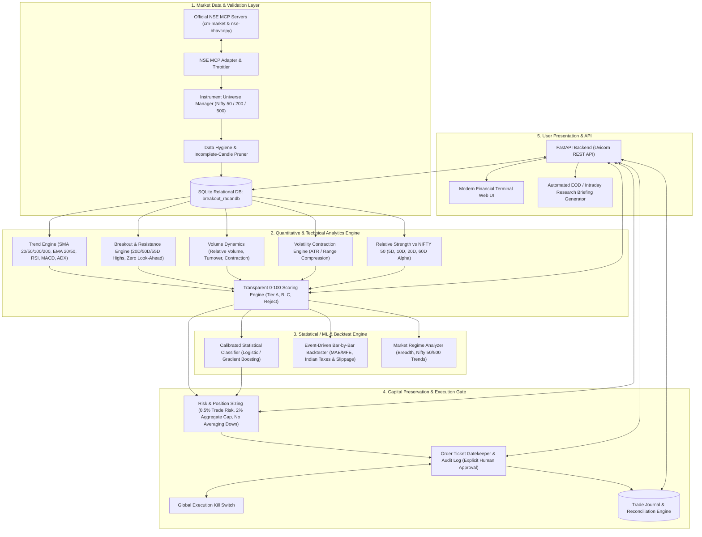

# Breakout Radar: Architecture & Implementation Specification



---

## Planned File Structure

```
├── config/
│   ├── trading_config.json             # Core risk parameters, tax rates, scanner thresholds
│   └── universe_config.json            # Nifty 50/100/200/500 constituents and metadata
├── data/
│   └── breakout_radar.db               # SQLite database for candles, watchlists, backtests, journal
├── docs/
│   ├── CAPABILITY_REPORT.md            # NSE MCP audit & tool matrix
│   └── ARCHITECTURE_SPEC.md            # System specification and blueprints
├── breakout_radar/
│   ├── __init__.py
│   ├── market_data/
│   │   ├── __init__.py
│   │   ├── nse_adapter.py             # Interface to NSE MCP tools
│   │   ├── universe_manager.py        # Nifty 50/200/500 liquid equity filter
│   │   ├── data_validator.py          # OHLC sanity, incomplete candle pruner, liquidity
│   │   └── storage.py                 # SQLite ORM / schema for historical cache & master
│   ├── indicators/
│   │   ├── __init__.py
│   │   ├── trend.py                   # SMA 20/50/100/200, EMA, RSI, MACD, ADX
│   │   ├── resistance.py              # 20D/50D/55D resistance without look-ahead bias
│   │   ├── volume.py                  # Relative volume, turnover, volume trends
│   │   ├── volatility.py              # Volatility contraction (VCP), ATR ratios
│   │   └── relative_strength.py       # Mansfield / ratio relative strength vs Nifty 50
│   ├── scanner/
│   │   ├── __init__.py
│   │   ├── pre_breakout.py            # Rule-based candidate detector (3-5 day horizon)
│   │   ├── scorer.py                  # Transparent 0-100 scoring engine with Tier A/B/C/Reject
│   │   └── regime.py                  # Market regime & breadth analyzer
│   ├── ml/
│   │   ├── __init__.py
│   │   ├── dataset_builder.py         # Chronological feature & target generation (no leakage)
│   │   └── breakout_classifier.py     # Calibrated Logistic & Gradient Boosting models
│   ├── backtest/
│   │   ├── __init__.py
│   │   ├── engine.py                  # Bar-by-bar event-driven backtesting engine
│   │   ├── cost_model.py              # Exact Indian statutory taxes (STT, DP, GST, Stamp)
│   │   └── metrics.py                 # MAE, MFE, Sharpe, Sortino, Drawdown, Expectancy
│   ├── risk/
│   │   ├── __init__.py
│   │   ├── sizer.py                   # Dynamic sizing: floor(min(risk_budget/risk_per_share, alloc/entry))
│   │   └── limits.py                  # 0.5% trade risk, 2% aggregate cap, averaging-down lock
│   ├── execution/
│   │   ├── __init__.py
│   │   ├── order_gate.py              # Order ticket preparation, approval gate, drift check
│   │   └── kill_switch.py             # Emergency halt
│   ├── journal/
│   │   ├── __init__.py
│   │   └── trade_journal.py           # SQLite trade journal, P&L, holdings reconciliation
│   ├── api/
│   │   ├── __init__.py
│   │   └── app.py                     # FastAPI backend application & routes
│   └── reports/
│       ├── __init__.py
│       └── daily_briefing.py          # EOD and intraday Markdown report generator
├── tests_python/
│   ├── test_data_validator.py
│   ├── test_indicators.py
│   ├── test_pre_breakout.py
│   ├── test_scorer.py
│   ├── test_risk_sizer.py
│   ├── test_backtester.py
│   └── test_order_gate.py
├── run_breakout_radar.py              # Main Python launcher
└── README.md
```

---

## Concrete Implementation Sequence

1. **Phase 1: Market Data Adapter & Instrument Master**
   - Implement `breakout_radar/market_data/nse_adapter.py` connecting to Official NSE MCP tools.
   - Implement `universe_manager.py` with Nifty 50 / 200 / 500 universe presets.
   - Implement `data_validator.py` and `storage.py` (SQLite database).
   - Write tests: `tests_python/test_data_validator.py`.

2. **Phase 2: Technical Analysis & Resistance Engine**
   - Implement `indicators/trend.py`, `resistance.py`, `volume.py`, `volatility.py`, `relative_strength.py`.
   - Strictly guarantee zero look-ahead bias (resistance derived strictly from prior $T-N$ to $T-1$ candles).
   - Write tests: `tests_python/test_indicators.py`.

3. **Phase 3: Pre-Breakout Scanner & Transparent 100-Point Scorer**
   - Implement `scanner/pre_breakout.py` (3-5 day horizon candidate detection).
   - Implement `scanner/scorer.py` (0-100 points: Trend 20, RS 20, Resistance 20, Volume 15, VCP 10, Liquidity 10, R:R 5).
   - Implement `scanner/regime.py` (Market breadth & regime).
   - Write tests: `tests_python/test_pre_breakout.py` and `tests_python/test_scorer.py`.

4. **Phase 4: Capital Preservation & Risk Sizing Engine**
   - Implement `risk/sizer.py` and `limits.py` adhering to initial ₹2,00,000 capital ($0.5\%$ risk budget = ₹1,000; $2.0\%$ aggregate ceiling = ₹4,000; $20\%$ max allocation = ₹40,000; max 5 positions; no averaging down).
   - Exact statutory tax & fee model (STT, Stamp Duty, Brokerage, GST, DP, SEBI, Slippage).
   - Write tests: `tests_python/test_risk_sizer.py`.

5. **Phase 5: Event-Driven Backtesting & Statistical ML Classifier**
   - Implement `backtest/engine.py` simulating next 3-5 sessions, MAE/MFE, realistic costs.
   - Implement `ml/breakout_classifier.py` with walk-forward chronological train/test splits and probability calibration.
   - Write tests: `tests_python/test_backtester.py`.

6. **Phase 6: Order Gatekeeper, Kill Switch & SQLite Trade Journal**
   - Implement `execution/order_gate.py` with explicit approval workflow, price-drift verification, and global kill switch.
   - Implement `journal/trade_journal.py` storing proposed trades, paper fills, P&L, and portfolio holdings reconciliation.
   - Write tests: `tests_python/test_order_gate.py`.

7. **Phase 7: FastAPI REST API & Modern User Dashboard**
   - Implement `api/app.py` serving REST endpoints for scanner, candidates, journal, risk, and backtests.
   - Update `public/index.html` with financial-terminal UI, multi-tab Breakout Radar view, stock detail charts, and interactive sizing.
   - Create unified runner `run_breakout_radar.py`.
   - Run end-to-end integration tests.

